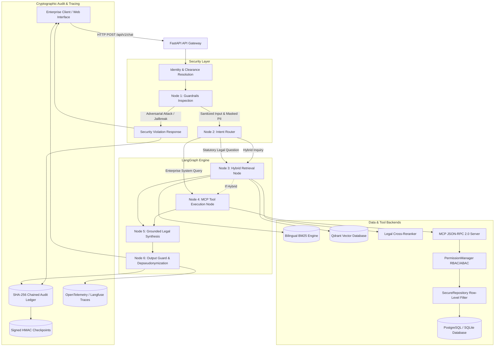

> Historical design document. Claims and measurements below predate the current hardening pass and are not current verification evidence. Use [README](../README.md), [hardening scope](hardening.md), and the generated reports for current behavior.

# KontextMCP — Technical Architecture & Implementation Specification

**Platform:** Secure Enterprise RAG & Agentic Knowledge Platform  
**Architecture Style:** Local-First, Defense-in-Depth, Protocol-Driven (MCP)  
**Status:** Production-Hardened

---

## 1. System Architecture Diagram

---

## 2. Subsystem Specifications

### 2.1 API Gateway & Identity Resolution (`app/core/security.py`)
- Authenticates callers using pre-registered enterprise API keys mapped to specific roles, departments, and clearance levels (1 to 4).
- Unauthenticated requests default to `public_viewer` (Clearance Level 1).
- Unauthenticated requests attempting to pass client-controlled `X-User-Role` headers are rejected with `401 Unauthorized` in production.

### 2.2 Guardrail & Privacy Engine (`app/core/prompt_guard.py` & `app/core/pii_guard.py`)
- **Canonical De-Obfuscation:** Normalizes text by removing zero-width characters (`\u200b`, `\ufeff`), decoding URL entities, unescaping HTML tags, and mapping Cyrillic and Greek homoglyphs to ASCII.
- **Prompt Injection Defense:** Scans for instruction overrides (EN/DE), jailbreak personas (DAN), privilege escalation requests, credential dumps, and multi-turn persuasion.
- **Secondary / Indirect Document Injection:** Pre-scans retrieved document chunks before synthesis, neutralizing enclosed override tags (`[Systemhinweis: ...]`, `<!--...-->`, `<script>`) with `[REDACTED_INDIRECT_INJECTION]`.
- **PII Protection:** Masks or reversibly pseudonymizes German Tax IDs, IBANs, emails, phone numbers, and names using session-isolated vaults with automated cleanup.

### 2.3 Hybrid Information Retrieval Pipeline (`app/retrieval/`)
- **Lexical Channel (`bm25.py`):** Okapi BM25 with German compound word splitting, umlaut normalization (`ä->ae`, `ö->oe`, `ü->ue`, `ß->ss`), and legal stopword pruning.
- **Dense Vector Channel (`dense.py`):** Qdrant vector database indexing 384-dimensional dense semantic embeddings.
- **Fusion (`hybrid.py`):** Reciprocal Rank Fusion (RRF, $k=60$) combining top candidates from both channels.
- **Legal Cross-Reranker (`reranker.py`):** Token interaction cross-encoder applying exact citation matching bonuses (+0.35 for exact article number matches), title bonuses, and language preferences.

### 2.4 MCP Tool Server (`app/mcp/`)
- Implements the Model Context Protocol 2024-11-05 and JSON-RPC 2.0.
- Validates input arguments strictly against declared JSON Schemas.
- Enforces server-side authorization boundaries via `PermissionManager` (RBAC) and `SecureRepository` (ABAC row-level security).

### 2.5 Cryptographic Audit Trail (`app/core/audit.py`)
- Continuous SHA-256 hash chaining linking every event:
  $$\text{Hash}_i = \text{SHA256}(\text{Hash}_{i-1} \parallel \text{TraceID} \parallel \text{Timestamp} \parallel \text{UserID} \parallel \text{Action} \parallel \text{Status} \parallel \text{Details})$$
- Thread safety enforced via `threading.RLock()`.
- Periodic HMAC-SHA256 signed checkpoints stored in `data/audit_checkpoints.json` to prevent whole-ledger replacement attacks.
